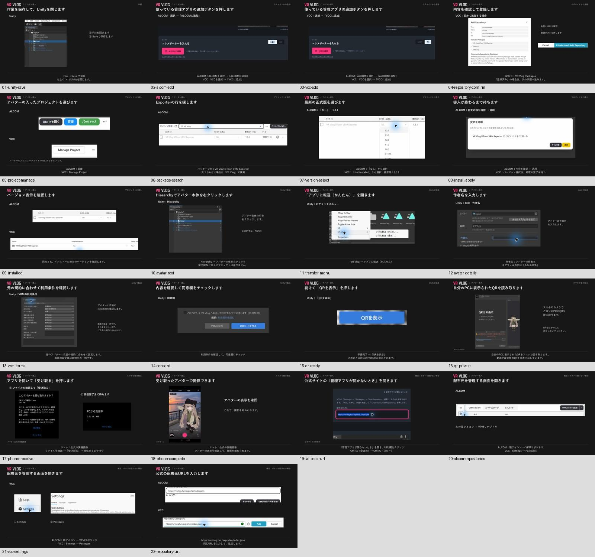

# アバター導入・画像案内用の参考素材（収集第1版）

出典: [公開ガイド](https://vrvlog.fun/guide/)。今回は素材整理のみで、画像案内への置換は未実装。

## 取得できたもの

公開済み動画から22枚を1920×1080 PNGで取得。実操作録画や既存画面画像を含む**動画の説明スライド**であり、未加工のアプリ全画面キャプチャではない。見出し・字幕・切り抜き・秘匿処理は元動画のまま。今回追加した描画・デザイン・マスクはない。

スマホの場面は既存サイト画像を動画に配置したもの。既存受信画像はAndroidエミュレーター由来。**本タスクで新たに撮影した物理端末画像は未収集**。PC・アプリの収録時ビルド番号やOSが未記録のため、最新UIとの一致や現在の動作成功の証拠にしない。動画内の1.3.1等は当時の例であり、現在の最新版を指示するものではない。

| 素材 | 動画時刻 | 閲覧 |
|---|---|---|
| Unityの保存 | 00:21 | [01-unity-save.png](01-unity-save.png) |
| ALCOM追加ボタン | 00:54 | [02-alcom-add.png](02-alcom-add.png) |
| VCC追加ボタン | 01:00 | [03-vcc-add.png](03-vcc-add.png) |
| 配布元確認 | 01:16 | [04-repository-confirm.png](04-repository-confirm.png) |
| プロジェクト管理 | 01:32 | [05-project-manage.png](05-project-manage.png) |
| パッケージ検索 | 01:43 | [06-package-search.png](06-package-search.png) |
| バージョン選択 | 01:58 | [07-version-select.png](07-version-select.png) |
| 変更を適用 | 02:07 | [08-install-apply.png](08-install-apply.png) |
| 導入済み確認 | 02:18 | [09-installed.png](09-installed.png) |
| アバター本体選択 | 02:36 | [10-avatar-root.png](10-avatar-root.png) |
| かんたん転送メニュー | 02:48 | [11-transfer-menu.png](11-transfer-menu.png) |
| 名前・作者名 | 03:05 | [12-avatar-details.png](12-avatar-details.png) |
| VRM利用条件 | 03:16 | [13-vrm-terms.png](13-vrm-terms.png) |
| 同意欄 | 03:25 | [14-consent.png](14-consent.png) |
| QR表示ボタン | 03:40 | [15-qr-ready.png](15-qr-ready.png) |
| 非公開QRの説明 | 03:50 | [16-qr-private.png](16-qr-private.png) |
| スマホ受信・受信中 | 04:04 | [17-phone-receive.png](17-phone-receive.png) |
| 受信後の表示 | 04:14 | [18-phone-complete.png](18-phone-complete.png) |
| 手動追加用URL | 04:41 | [19-fallback-url.png](19-fallback-url.png) |
| ALCOM配布元管理 | 04:50 | [20-alcom-repositories.png](20-alcom-repositories.png) |
| VCC設定 | 04:56 | [21-vcc-settings.png](21-vcc-settings.png) |
| 配布元URL入力 | 05:10 | [22-repository-url.png](22-repository-url.png) |

## 再利用できる既存の画面素材

元の素材はすでにこのリポジトリにあるため重複コピーせずリンクする。`public/exporter/`は同期物なので編集しない。出典詳細は[元のREADME](../../public/exporter/assets/guide/README.md)を参照。

| 素材 | 既存ファイル | 出典と限界 |
|---|---|---|
| ALCOM導入 | [alcom-install.webp](../../public/exporter/assets/guide/alcom-install.webp) | 既存ガイド用画面。個人名・パスは一般化済み |
| Unityメニュー | [unity-transfer-menu.png](../../public/exporter/assets/guide/unity-transfer-menu.png) | 既存ガイド用画像 |
| アバター選択 | [unity-avatar-menu.png](../../public/exporter/assets/guide/unity-avatar-menu.png) | 既存ガイド用切り抜き。Scene/Object名一般化済み |
| Unity転送 | [unity-qr-transfer.png](../../public/exporter/assets/guide/unity-qr-transfer.png) | 本人提供、名前・作者名一般化済み |
| スマホ受信確認 | [phone-receive.webp](../../public/exporter/assets/guide/phone-receive.webp) | Androidエミュレーター。物理端末ではない |
| VCC登録 | [vcc-add-repository.webp](../../public/exporter/assets/guide/vcc-add-repository.webp) | VRChat公式ドキュメント引用。今回の実操作ではない |
| VCC設定 | [vcc-repositories.webp](../../public/exporter/assets/guide/vcc-repositories.webp) | 同上 |
| VCCバージョン | [vcc-installed-version.webp](../../public/exporter/assets/guide/vcc-installed-version.webp) | 同上 |

VCC引用元: https://vcc.docs.vrchat.com/guides/community-repositories/

## 追加収集が必要なもの

- 現行iOS/Android実機の「カメラ読取 → リンクからアプリ起動 → 受信確認 → 受信中 → アバター選択・撮影」。端末識別子/OS/アプリ版・buildと同じ操作の証跡が必要。
- ALCOM/VCC両系統の現行・同条件の全画面原本。動画では一部が切り抜き・静止画・説明合成になっている。
- 必要なら現在の読み込み中・通信失敗・取消・期限切れの画像。正常系から推測して作らない。

## 取得・検証・権利

- 固定参照revision: `ccd584b00996b9bde382a07688c5ffb74c1f320f`。対象動画 `public/guide/vrvlog-start-guide.mp4`、11,833,830 bytes、Git blob `4df4b1a38ec92b5a98601e161c8f56e029b69ca8`。
- 元動画SHA-256: `be86956d233726ead59282f66a422ca771a0e0e33d5b98f64b102552279f5015`。既存docs/assets.mdと一致。
- 2026-11-04 JST、macOS AVFoundationで時間許容差0のフレーム抽出。全22枚の実時刻・サイズ・SHA-256は[frames.json](frames.json)。一覧画像のみ縮小して配置。
- 動画の再ダウンロードやブラウザでのスクリーンショットを原寸素材の代わりに使う必要はない。出典と時刻から再抽出できる。
- QRは元動画で非表示。案内画像に読取り可能なコードを追加しない。作者名「もち山金魚」等の公開クレジットは秘密情報ではない。
- アバター: キプフェル、©もち山金魚。動画音声: VOICEVOX:ずんだもん（静止画に音声なし）。[既存の素材規定](../assets.md)を継承し、画像・アバター・ロゴの追加ライセンスを付与しない。
- 保存分類: saved、本タスク所有、22枚計6,551,659 bytes。本人確認まで原本保持。動画一時コピー・抽出キャッシュはリポジトリへ含めない。
