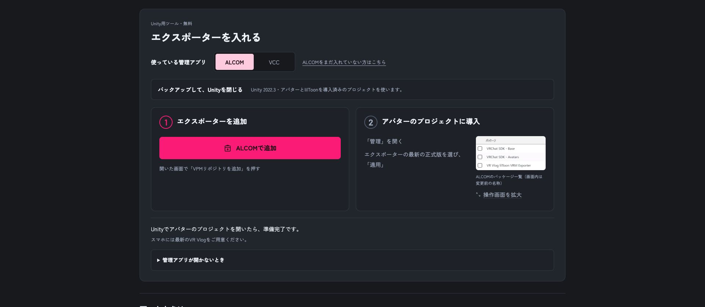
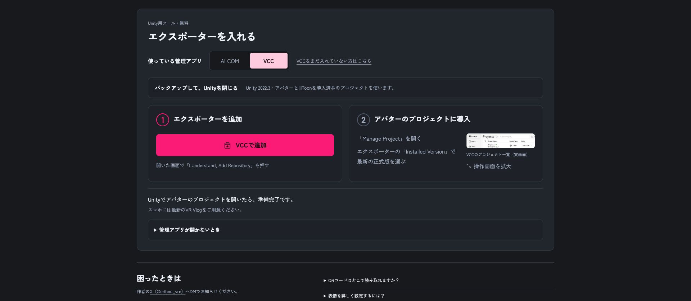

# アバター導入案内用・実画面素材（収集中）

[ガイド動画](https://vrvlog.fun/guide/)は必要な操作場面を特定する参考にのみ使う。**素材は実際に表示したブラウザ・アプリ・物理端末の画面から撮影する。動画のフレームや説明スライドは含めない。**

## 取得済み：実ブラウザ

2026-11-04 JST、操作担当Terraが https://vrvlog.fun/exporter/ を専用Chromeタブで表示。「エクスポーターを入れる」セクションを表示し、ALCOM/VCCの表示切替だけを行って撮影。外部管理アプリを起動する追加ボタンは押していない。

| 状態 | 撮影画像 |
|---|---|
| ALCOM選択 | [current-exporter-alcom.png](current-exporter-alcom.png) |
| VCC選択 | [current-exporter-vcc.png](current-exporter-vcc.png) |

画像は1920×839、PCブラウザの実表示。取得時のJPEGスクリーンショットをPNGに変換したもの。モックアップ・動画切り出しではない。サイト内に埋め込まれたサンプル画像はサイト表示の一部であり、ALCOM/VCCアプリ自体を今回操作・撮影した証拠ではない。Chromeバージョン・プロファイル・ズーム等の未記録条件は確認中。

## 取得済み：ALCOM実アプリ

macOS 27.0.1 (26A434)、ALCOM 1.1.8 (build 1.1.8)、日本語・ダークテーマ。2026-11-04 JST、アプリのウィンドウだけを原寸1412×912で撮影。動画・合成・再描画なし。

- [alcom-repositories.png](alcom-repositories.png)：VPMリポジトリ一覧。元の設定に旧Exporter URLが登録されているが、撮影のために登録情報は変更していない。推奨URLとして旧URLを転記しない。
- [alcom-add-repository-url.png](alcom-add-repository-url.png)：追加ダイアログに公式URL `https://vrvlog.fun/exporter/index.json` を入力した状態。登録送信せずキャンセルした。

私用プロジェクト名のある初期画面は公開対象から除外。ダイアログを閉じ、元タブと元の前面アプリへ戻したことを確認。アプリ更新・パッケージ導入・プロジェクト変更は行っていない。

## 取得済み：iPhone実機

[ios-capture-current.png](ios-capture-current.png)：iPhone 15 Pro Max、iOS 27.2、VR Vlog製品版1.2.2 build 486、2026-11-04 JSTの実機スクリーンショット（1290×2796）。現在の通常撮影画面であり、受信完了直後を再現した画像ではない。動画からの切り出し・モック・再描画なし。アバター表示と既存のログサムネイルを含み、モデル等の権利は元の条件に従う。

[ios-settings-top.png](ios-settings-top.png)：同じiPhone・OS・製品版で「設定」を開いた実画面（1290×2796）。「アバターを変更」「VRMライブラリ」が下部に表示。項目選択・設定値変更は行っていない。

[ios-settings-avatar-import.png](ios-settings-avatar-import.png)：同じ条件で設定を1回スクロールし、「VRMライブラリ」「VRoid Hub」「QRコードで受け取る」の入口を撮影（1290×2796）。受信操作やモデル変更は行っていない。

操作担当Terraが正規予約・既存Appium経路で取得し、元の前面へ復元。操作停止・EOF・session終了・native lock解放と、同bindingの論理予約released・対象予約0を読戻し確認した。端末識別子・予約binding等のprivate証跡は公開リポジトリへ含めない。

## 未収集：実際のアプリ・実機

- ALCOM：登録完了・プロジェクト管理・パッケージ検索・版選択・適用・導入済みの必要な状態。VCC：アプリ自体の全状態。
- Unity：アバター本体の選択、かんたん転送メニュー、名前・作者・利用条件・同意、転送準備・QR表示（機密を含む実QRは公開しない）。
- iOS/Android実機：カメラ読取、リンクからアプリを開く、受信確認、受信中、受信完了・アバター選択・撮影画面。
- 補足：VCCの配布元URL手動追加。必要に応じて失敗・取消・期限切れ。ALCOMの手動URL入力画面は取得済み。

各素材に対象OS・アプリ版/build・操作状態・撮影条件を記録する。端末の接続・認証・登録・予約・native lockの確認前は操作を開始しない。他タスクの端末やプロジェクトは変更しない。実機未撮影をエミュレーター画像で代替済みと扱わない。

## 保存・権利

本タスク所有のsaved素材。本人確認まで原本保持。保存上限100MiB。取得済み画像のSHA-256と寸法は[captures.json](captures.json)。アバター・ロゴ等は[既存の素材規定](../assets.md)に従い、追加ライセンスを付与しない。

今回は素材収集とリポジトリへの追加まで。ガイドUIの実装・置換・本番公開は未実施。

## 現在の制約

Unityは別タスクのAndroid CIで使用中。今回使えるアバター用プロジェクトは未特定であり、本人へ撮影環境の指定を依頼している。VCCの実行環境も未特定。Android実機は過去操作の停止未確認記録を保護し、今回触れていない。素材集は未完了で、受信・転送が動作したとは主張しない。
