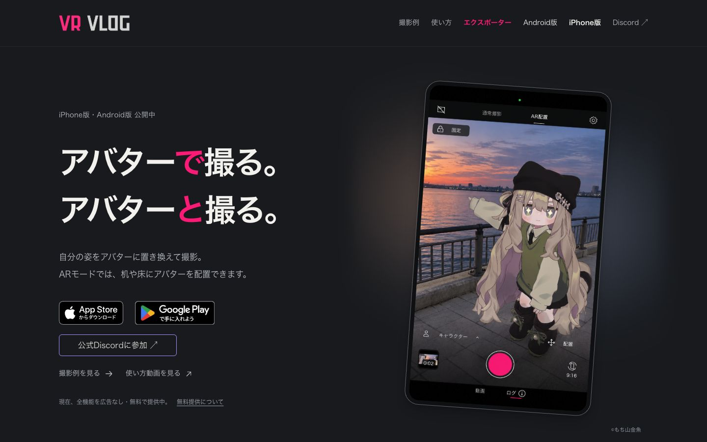
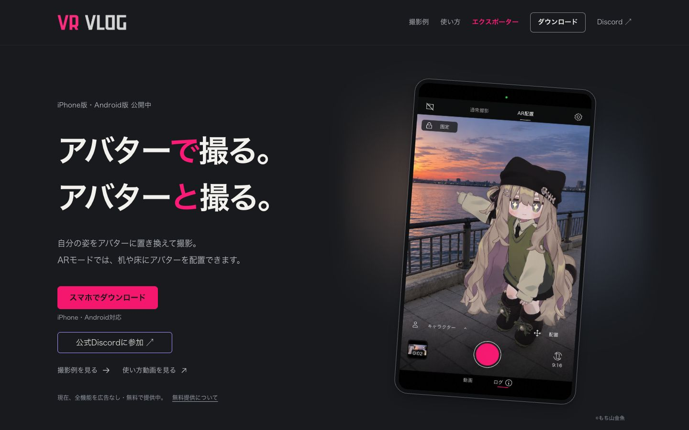
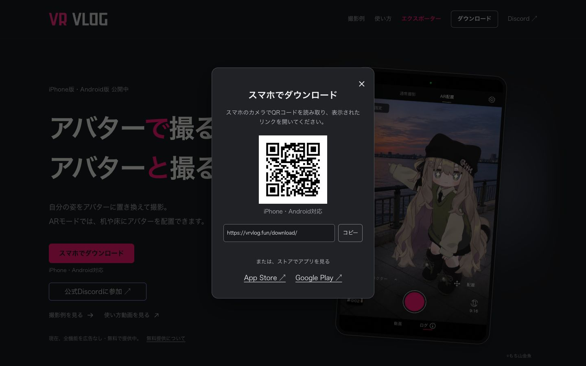
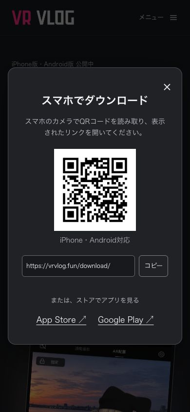

# PCからスマホへのダウンロード導線 B案

Epic #46。本人が採用したB案に基づく実装比較。

## 画面比較

変更前は2026-11-08の公開サイトをChrome 1440×900・日本語・暗色で撮影。公開版の正確なrevisionは未確認。
変更後はc26cc77b92f2ee090df960bac98568f043fbe248の静的ビルド出力を同じ1440×900のChromeで撮影した実行画面。390px画像はPC Chromeのviewport変更で、実スマートフォンの撮影ではない。

| 変更前 | 変更後（実行画面） |
| --- | --- |
|  |  |

PCでダウンロードを押した後の実行画面。

## 差分

- ヘッダー・hero・ページ下部のダウンロードを共通導線へ統一。
- PCではnative dialogに共通QR、読取案内、URLコピー、両ストアリンクを表示。
- iPhone/iPodとAndroidでは既存の対応ストアURLへ直接進む。画面幅でOSを決めない。
- QRは https://vrvlog.fun/download/ を格納。公開後にこのURLが有効になる。
- 判定不能時やJS無効時は専用ページでストアを選べる。既存のDiscord・エクスポーター・対応環境のリンクを維持。

## 検証

実行ソースを固定して、ルーティングと既存計測の14テスト、取得導線の16テスト、型検査、既存build:pages、出力39項目の監査が成功。追加したモバイル初期化/QR着地点の対象テストを含む最終ダウンロードテスト5件が成功。実行時ソースを変えていないテストのみの追加では、成功済みビルドを再実行していない。

QRのSVGを別デコーダーで復号して共通URLとの一致を確認。実装担当による敵対的セルフレビューを実施し、ページ下部の既存CSSによる上書きの可能性を修正してから検証。

ブラウザ操作の詳細と実機・他言語等の未確認事項はPRの検証結果を参照。公開版・実機インストールの確認とは区別する。
